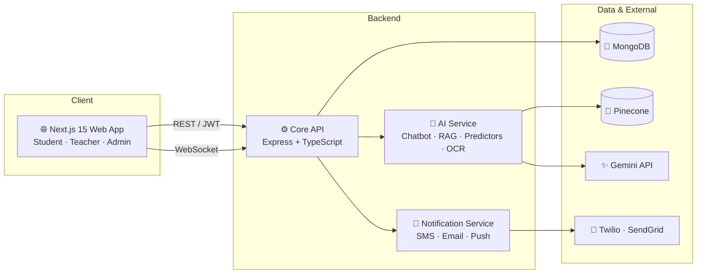

<div align="center">

# 🎓 Salok University Management System

### An AI-powered, all-in-one smart campus platform — admissions to placements, in one monorepo.


[Features](#-features) • [Architecture](#-architecture) • [Tech Stack](#-tech-stack) • [Getting Started](#-getting-started) • [Roles](#-roles--permissions) • [Roadmap](#-roadmap) • [Contributing](#-contributing)

</div>

---

## 📖 Overview

**Salok University Management System** digitizes the complete student lifecycle — from the first admission form to the final placement offer. It combines a modern web app with dedicated **AI** and **Notification** microservices, so routine campus work (scheduling, grading support, document verification, complaint triage, resume screening) is automated and data-driven.

**Why Salok?**

| 🎯 Problem | ✅ How Salok solves it |
|---|---|
| Manual, paper-heavy admissions | End-to-end digital admissions with OCR + face-match document verification |
| Timetable clashes | AI-optimized scheduling with automatic conflict detection |
| Slow, repetitive grading | AI-assisted grading and rubric generation |
| Scattered campus communication | One multi-channel center (SMS, Email, Push) with audit logs |
| Reactive student support | Predictive analytics to flag at-risk students early |
| Hard-to-find policies & schedules | RAG-powered AI chatbot that answers in seconds |

---

## 📸 Screenshots

> Add screenshots / GIFs here — they make a README 10x more convincing.

| Student Dashboard | Attendance Heatmap | Live Bus Tracking |
|:---:|:---:|:---:|
| `docs/screenshots/dashboard.png` | `docs/screenshots/attendance.png` | `docs/screenshots/transport.png` |

---


### 🏫 Core Modules

| Module | What it does |
|---|---|
| 🔐 **Authentication & Authorization** | Secure JWT-based login with role-based access control (Admin, Teacher, Student) |
| 📝 **Admissions Portal** | Complete onboarding workflow — application, document verification, and fee payment |
| 👨‍🎓 **Student Management** | Centralized student records, profiles, and academic history |
| 🧑‍💻 **Self-Portal** | Student dashboard for profile, fees, and academic progress |
| ✅ **Attendance System** | QR code / facial recognition attendance with heatmap visualizations |
| 🗓️ **Timetable Management** | AI-optimized scheduling for classes, labs, and exams — conflict detection + Google Calendar sync |
| 📚 **Assignments** | Creation → submission → AI-assisted grading → rubric generation |
| 🧪 **Examinations** | Exam scheduling, hall-ticket generation, marks entry, result processing |
| 🏠 **Hostel** | Room allocation, mess menu management, complaint tracking |
| 🚌 **Transport** | Live bus GPS tracking (Socket.io), route management, fuel & maintenance logs |
| 💼 **Placement Cell** | Company drive tracking, resume builder, mock interviews, application status |
| 📢 **Communication Center** | Multi-channel notice broadcasting (SMS, Email, Push) and AI-categorized complaint queues with audit logs |

### 🤖 AI & Notification Microservices

| Service | Capability |
|---|---|
| 💬 **AI Assistant (Chatbot)** | RAG-based conversational AI (Pinecone + Gemini) for schedules, policies, and FAQs |
| 📄 **Resume Analyzer** | ATS scoring and keyword extraction for student resumes |
| 📈 **Performance & Package Predictor** | Predicts class pass rates, flags at-risk students, estimates expected placement packages |
| 🪪 **Document AI** | OCR + face match for automated admission-document verification |
| 🔔 **Notification Engine** | Real-time push and email alerts for transport, assignments, and campus notices |

---

## 🏗️ Architecture

Salok is a **monorepo** with a Next.js frontend, a core REST API, and two independent microservices.



### 📁 Project Structure

```
SALOK/
├── apps/
│   ├── web/                    # Next.js 15 frontend (App Router)
│   ├── server/                 # Express.js core backend API
│   ├── ai-service/             # AI microservices (chatbot, RAG, predictors, OCR)
│   └── notification-service/   # Notification workers & API
├── .env.example                # Template for environment variables
├── .prettierrc                 # Code formatting rules
└── package.json                # Workspace root
```

---

## 💻 Tech Stack

| Layer | Technologies |
|---|---|
| **Frontend** | Next.js 15 (App Router), React, Tailwind CSS, Lucide Icons |
| **Backend** | Node.js, Express.js, TypeScript |
| **Database** | MongoDB with Mongoose ODM |
| **Realtime** | Socket.io (live bus GPS tracking) |
| **AI / ML** | Gemini, RAG pipeline, Pinecone vector DB, OCR & face matching |
| **Notifications** | Twilio (SMS), SendGrid (Email), Push |
| **Auth** | JWT + role-based access control |
| **Architecture** | Monorepo, microservices |
| **Tooling** | Prettier, npm workspaces |

---

## ⚙️ Getting Started

### Prerequisites

- **Node.js** v18 or higher
- **MongoDB** — local instance or [MongoDB Atlas](https://www.mongodb.com/atlas)
- **API keys** for: Gemini, Pinecone, Twilio, SendGrid

### Installation

```bash
# 1. Clone the repository
git clone https://github.com/Akshatsrii/Salok-University.git
cd Salok-University

# 2. Install dependencies (workspace root)
npm install

# 3. Set up environment variables
cp .env.example .env
```

### 🔑 Environment Variables

Fill in `.env` at the project root. Example layout (match names to your `.env.example`):

```env
# --- Core ---
NODE_ENV=development
PORT=5000
MONGODB_URI=mongodb://localhost:27017/salok
JWT_SECRET=your_super_secret_key
JWT_EXPIRES_IN=7d

# --- AI Service ---
GEMINI_API_KEY=your_gemini_key
PINECONE_API_KEY=your_pinecone_key
PINECONE_INDEX=salok-knowledge-base

# --- Notification Service ---
TWILIO_ACCOUNT_SID=your_sid
TWILIO_AUTH_TOKEN=your_token
TWILIO_PHONE_NUMBER=+10000000000
SENDGRID_API_KEY=your_sendgrid_key
EMAIL_FROM=no-reply@salok.edu

# --- Frontend ---
NEXT_PUBLIC_API_URL=http://localhost:5000
```

> ⚠️ **Never commit your `.env` file.** Only `.env.example` should be tracked.

### ▶️ Running the Project

```bash
# Run everything in development mode
npm run dev
```

Or run services individually:

```bash
npm run dev --workspace=apps/web                   # Frontend
npm run dev --workspace=apps/server                # Core API
npm run dev --workspace=apps/ai-service            # AI service
npm run dev --workspace=apps/notification-service  # Notification service
```

| Service | Default URL |
|---|---|
| Web App | `http://localhost:3000` |
| Core API | `http://localhost:5000` |

> Ports and script names depend on your workspace config — adjust to match your `package.json` files.

---

## 🔒 Roles & Permissions

| Capability | 🎓 Student | 👩‍🏫 Teacher | 🛡️ Admin |
|---|:---:|:---:|:---:|
| Self-portal (profile, fees, progress) | ✅ | — | ✅ |
| View attendance | ✅ | ✅ | ✅ |
| Mark attendance | — | ✅ | ✅ |
| Submit assignments | ✅ | — | — |
| Manage assignments & AI rubrics | — | ✅ | ✅ |
| View timetable | ✅ | ✅ | ✅ |
| View exam results | ✅ | ✅ | ✅ |
| Enter exam marks | — | ✅ | ✅ |
| Predictive analytics | — | ✅ | ✅ |
| AI tools (chatbot, resume analyzer) | ✅ | ✅ | ✅ |
| Admissions management | — | — | ✅ |
| Exam scheduling | — | — | ✅ |
| Bulk communications | — | — | ✅ |
| System-wide management | — | — | ✅ |

---

## 🗺️ Roadmap

- [x] Authentication & role-based access control
- [x] Admissions, student management & self-portal
- [x] Attendance, timetable, assignments & examinations
- [x] Hostel, transport & placement modules
- [x] AI chatbot, resume analyzer & predictors
- [ ] Mobile app (React Native)
- [ ] Parent portal
- [ ] Library management module
- [ ] Multi-language support (Hindi + English)
- [ ] Docker & CI/CD pipeline
- [ ] Automated test coverage (unit + e2e)

---

## 🤝 Contributing

Contributions are welcome!

1. **Fork** the repository
2. Create a feature branch: `git checkout -b feature/amazing-feature`
3. Commit your changes: `git commit -m "feat: add amazing feature"`
4. Push to your branch: `git push origin feature/amazing-feature`
5. Open a **Pull Request**

Please follow the existing Prettier configuration and use [Conventional Commits](https://www.conventionalcommits.org/) for commit messages.

---

## 📄 License

Distributed under the **MIT License**. See `LICENSE` for details.

---

## 👤 Author

**Akshat Srivastava**

[](https://github.com/Akshatsrii)

---

<div align="center">

⭐ **If you found this project useful, consider giving it a star!** ⭐

*Built for Salok University.*

</div>
